PROFILE · USERMAYALIVE · LIVE

  

  <b>AI/ML engineer · distributed systems · full-stack</b> · B.Tech CSE, IIIT Pune  
  I build LLM systems that can check their own answers, and storage engines that survive broker crashes.  
  <a href="https://github.com/Usermayalive">GitHub</a>

✦ ─────────────────────────────── ✦

## Where the work lives

  

✦ ─────────────────────────────── ✦

## AI / ML: LLMs that check their own work

**[VeriSync AI](https://github.com/Usermayalive/Verisync_ai)**: self-auditing multi-document assistant
- Three-layer adversarial pipeline (Causal Autopsy → Fake Chain Generator → Epistemic Judge). It only answers when the claim is grounded (cosine ≥ 0.75).
- Hybrid retrieval: pgvector dense + BM25/SPLADE sparse, fused with Reciprocal Rank Fusion. HyDE, RAPTOR and Chain-of-Verification reduce hallucinations.
- Multi-agent LangGraph state machine with retry edges, served through async FastAPI with streaming. A Next.js dashboard shows per-claim source attribution.

`Python` `LangGraph` `Gemini` `FastAPI` `Next.js` `pgvector` `PostgreSQL`

**GNN-Pruner**: graph-based RAG for ultra-long documents *(research, paper in preparation)*
- Hierarchical GNN that prunes >95% of a 10,000+ page document before the LLM sees it. It uses a 4-layer discourse graph, query-aware coarsening (~500K → ~5K nodes) and two-stage GraphSAGE scoring.
- Distributed inference on Ray: METIS sharding with boundary-node replication, so workers don't need to communicate.
- "Silver Path" weak supervision (BM25 + dense fallback) replaces LLM-labelled training data. Evaluated on BABILong, CUAD and FinQA.

`PyTorch Geometric` `Ray` `FAISS` `GraphSAGE`

✦ ─────────────────────────────── ✦

## Distributed systems: Kafka, rebuilt from scratch

**[kafka_ka_baap](https://github.com/Usermayalive/kafka_ka_baap)**: distributed event streaming platform
- Embedded Raft quorum (Apache Ratis) instead of ZooKeeper: leader election in ~1.1 s, broker failover in ~2.8 s, a single binary with no external coordinator.
- Segmented append-only log with a sparse offset index and group-commit WAL, reaching **223K ops/sec** end-to-end. Using the FFM API cut the index **98.5% (68× smaller)**, enough for 2,000 concurrent partitions.
- Cooperative consumer-group rebalancing (no stop-the-world pauses), a compacted `__consumer_offsets` topic, and S3-compatible tiered storage with Zstd.
- Idempotent producers that survive restarts (64-bit PIDs, epoch-based zombie fencing) and a native Dead Letter Queue.
- 120 tests and 8 multi-broker kill-and-recover runs. Benchmarked against Apache Kafka 4.3.1 on the same hardware: it matches Kafka above 4 KB payloads, with sub-ms p99.

`Java 25` `Netty` `Apache Ratis` `RocksDB` `Avro` `Prometheus`

**[my_own_simple_kafka](https://github.com/Usermayalive/my_own_simple_kafka)**: the first version
- Custom binary wire protocol over NIO ByteBuffers, ZooKeeper-based controller election, leader-follower replication with automatic failover, and segmented logs with sparse indexes.

`Java` `ZooKeeper` `NIO`

✦ ─────────────────────────────── ✦

## Product: shipped to real users

**[Smart Attendance System](https://github.com/Usermayalive/checkpoint-)**: *Indian patent, deployed on campus*
- BLE geofencing checks that you're in the room, and facial recognition (OpenCV, MediaPipe) checks that you're you. 99%+ verification accuracy.
- Real-time teacher dashboard (Socket.io + Firebase). Per-class attendance went from 5–10 minutes to under 30 seconds, for 1,000+ daily users.

`FastAPI` `Ionic Capacitor` `Supabase` `OpenCV` `MediaPipe` `Socket.io`

✦ ─────────────────────────────── ✦

## The tools behind the signal

  

Python · Java · TypeScript · JavaScript · C++ · SQL · chosen for the work, not the trend

## Built, shipped, shared

  

✦ ─────────────────────────────── ✦

## Track record

| | |
|---|---|
| 📜 **2 published Indian patents** | Smart Attendance (BLE + facial biometrics), 2025 · Wearable IoT airborne-infection risk detector, 2026 |
| 🏆 **Hackathons** | Top finishes in 10+ national and 2+ international hackathons |
| ⭐ **CodeChef 3-Star** | 200+ problems solved, top 5% globally |
| 🎓 **JEE Advanced** | AIR 12,000 out of 1.6M candidates (top 1%) |
| 🤝 **IEEE SB, IIIT Pune** | Vice Chairperson: leads a 45+ member team, events reaching 1,000+ students |

Cards regenerate daily from the GitHub API · <a href="./scripts/generate.mjs">how it works</a>

